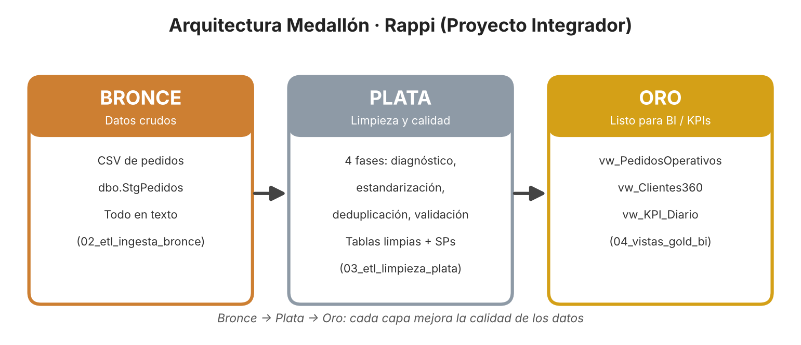
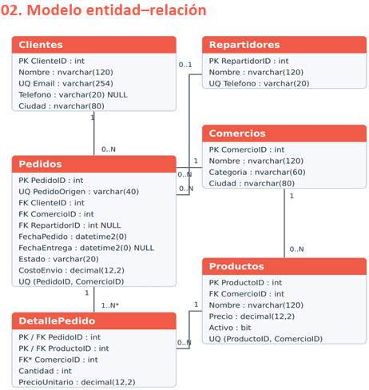

# Rappi · Proyecto Integrador de Integración de Datos

**Universidad Iberoamericana León** · Departamento de Ciencias Económico-Administrativas
**Asignatura:** Integración de Datos · **Profesor:** Julio César Moreno Ramón
**Periodo:** Otoño 2026

> Modelo académico con datos sintéticos. No describe la base de datos interna de Rappi.

## Equipo

| Integrante | Rol | Responsabilidad |
|---|---|---|
| Sohani Miliyani | Líder de proyecto | Coordina el avance, organiza Trello, integra el documento y realiza la entrega |
| Dana Mancillas | Arquitecta de datos | Diseña el DER, las tablas, las restricciones, las vistas y los procedimientos |
| Diego Hernández | Ingeniero ETL | Define la ingesta y desarrolla la limpieza en cuatro fases |
| Frida Suárez | Analista de calidad de datos | Diseña pruebas, valida la integridad y los indicadores, reúne evidencias |

Tablero de trabajo: **Rappi / Proyecto Integrador** en Trello → _(pega aquí el enlace del tablero)_

## Planteamiento

Cada pedido reúne datos del cliente, el comercio, los productos y el repartidor. Los formatos distintos, los duplicados o las referencias incompletas dificultan el seguimiento y vuelven poco confiables los indicadores.

## Objetivo

Diseñar una base de datos relacional y un proceso de limpieza que integren pedidos y entregas para consultar la operación, conocer el historial de clientes y construir indicadores del servicio.

## Alcance

- Un comercio por pedido.
- Productos con precio histórico.
- Repartidor opcional antes de la entrega.
- Moneda MXN y fechas en hora local de León.
- Se excluyen pagos, promociones, devoluciones y rutas.

## Arquitectura medallón



| Capa | Qué contiene | Archivo |
|---|---|---|
| **Bronce** | Datos crudos en texto (`StgPedidos`) | `src/02_etl_ingesta_bronce.sql` |
| **Plata** | Datos limpios y validados, procedimientos almacenados | `src/03_etl_limpieza_plata.sql` |
| **Oro** | Vistas analíticas y KPIs | `src/04_vistas_gold_bi.sql` |

## Modelo entidad–relación



El modelo tiene 7 tablas: `Clientes`, `Comercios`, `Repartidores`, `Productos`, `Pedidos`, `DetallePedido` y `StgPedidos` (staging).

| Relación | Cardinalidad | Criterio |
|---|---|---|
| Cliente → Pedido | 1 a N | Cada pedido pertenece a un cliente |
| Comercio → Pedido | 1 a N | Un comercio por pedido |
| Repartidor → Pedido | 1 a N | Un pedido puede no tener repartidor |
| Comercio → Producto | 1 a N | Cada producto tiene un comercio |
| Pedido → Detalle | 1 a N | Un pedido tiene uno o más detalles |
| Producto → Detalle | 1 a N | Un producto puede estar en múltiples pedidos |
| Pedido ↔ Producto | N a N | Se resuelve con la tabla `DetallePedido` |

## Limpieza y calidad de datos

La fuente es un CSV UTF-8 de cabeceras de pedidos, con fechas ISO 8601 e importes en MXN. El proceso tiene cuatro fases:

1. **Diagnóstico:** perfilado de nulos, espacios, tipos, fechas, costos e identificadores repetidos (`COUNT`, `SUM`, `TRY_CONVERT`).
2. **Estandarización:** limpieza de texto, homologación de estados y conversión de IDs, fechas e importes (`TRIM`, `UPPER`, `TRY_CONVERT`).
3. **Deduplicación:** un registro por `PedidoOrigen`, conservando la primera ingesta (`ROW_NUMBER`, `PARTITION BY`).
4. **Validación y enriquecimiento:** cruce con clientes, comercios y repartidores; los registros inválidos se separan con su motivo (`LEFT JOIN`, `COALESCE`, `CHECK`).

No se imputan IDs, fechas ni dinero, y los costos negativos se rechazan.

## Vistas (capa Oro)

| Vista | Descripción |
|---|---|
| `vw_PedidosOperativos` | Una fila por pedido, con comercio, repartidor, unidades, subtotal, envío, total y minutos de entrega |
| `vw_Clientes360` | Resumen por cliente: pedidos, entregados, gasto y último pedido. Incluye clientes sin compras |
| `vw_KPI_Diario` | KPIs por fecha y comercio: pedidos, entregados, cancelados, valor, ticket promedio, tiempo y % de entrega |

## Procedimientos almacenados

| Procedimiento | Descripción |
|---|---|
| `usp_RegistrarCliente` | Inserta un cliente con validaciones, transacción y `TRY/CATCH`; evita emails duplicados |
| `usp_ConsultarCliente` | Consulta un cliente por ID con datos estandarizados |
| `usp_HistorialCliente` | Historial de pedidos de un cliente en un rango de fechas |

Ejemplos:

```sql
EXEC dbo.usp_ConsultarCliente @ClienteID = 1;

EXEC dbo.usp_HistorialCliente
     @ClienteID = 1, @FechaInicio = '20261001', @FechaFin = '20261001';
```

## Cómo ejecutar el proyecto

Requiere SQL Server 2019/2022 y SSMS. Usa una **base de datos vacía**. Ejecuta los scripts de `src/` en este orden:

1. `01_ddl_arquitectura_der.sql`: crea las tablas, restricciones e índices.
2. `02_etl_ingesta_bronce.sql`: carga los datos crudos en `StgPedidos`.
3. `03_etl_limpieza_plata.sql`: limpieza y procedimientos almacenados.
4. `04_vistas_gold_bi.sql`: crea las vistas.

> Los procedimientos y las vistas se pueden crear en cualquier orden, pero `usp_HistorialCliente` solo se puede ejecutar cuando `vw_PedidosOperativos` ya existe.

## Estructura del repositorio

```
rappi-proyecto-integrador/
├── src/
│   ├── 01_ddl_arquitectura_der.sql
│   ├── 02_etl_ingesta_bronce.sql
│   ├── 03_etl_limpieza_plata.sql
│   └── 04_vistas_gold_bi.sql
├── assets/
│   ├── logo_negocio.png
│   ├── flujo_medallon_sql.png
│   └── diagrama_der_sqlserver.png
└── README.md
```
